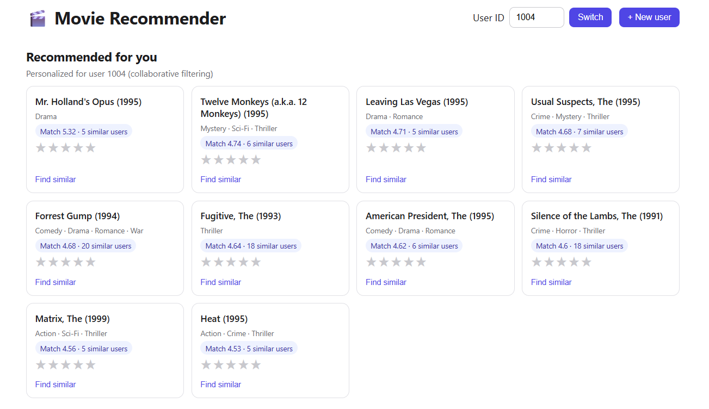
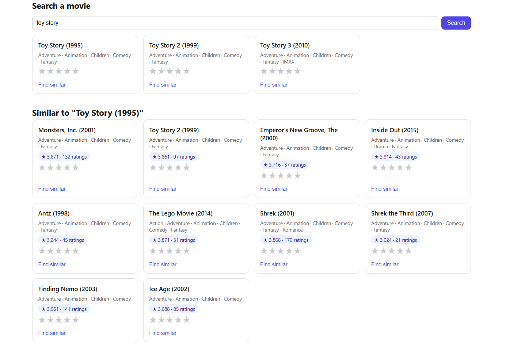
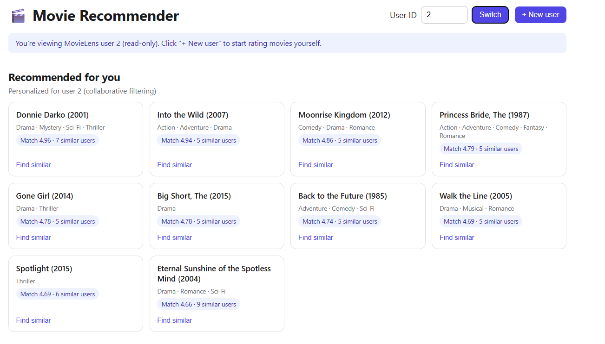

# 🎬 Movie Recommender

A full-stack recommendation engine built on the MovieLens dataset. It combines
popularity, content-based, and collaborative filtering, served through a FastAPI
backend with a React frontend and SQLite storage for new users.
**Personalized recommendations for a new user (after rating movies):**



**Search and similar movies:**



**MovieLens user (read-only view):**



## Features

- **Popularity baseline**: top-rated movies with a minimum rating count
- **Content-based**: "similar movies" from genre TF-IDF vectors, blended with average rating
- **Collaborative filtering**: user-based k-NN with mean-centered cosine similarity
- **New users**: create an account, rate movies, and get personalized recommendations
  after 5 ratings (stored in SQLite, computed on the fly)
- **Cold-start handling**: unknown or new users fall back to popular movies

## Architecture

```
React (Vite)  ──HTTP──▶  FastAPI  ──▶  precomputed model (joblib)
                            │
                            └──▶  SQLite (app users + their ratings)
```

## Results

Evaluated on an 80/20 random split of MovieLens ml-latest-small
(about 100k ratings, 610 users, 9.7k movies).

| Method               | RMSE   | Precision@10 | Recall@10 |
| -------------------- | ------ | ------------ | --------- |
| Global mean          | 1.0488 | n/a          | n/a       |
| Movie mean           | 0.9827 | n/a          | n/a       |
| Popularity           | n/a    | 0.072        | 0.049     |
| User-based CF, k=10  | 0.9645 | 0.120        | 0.121     |
| User-based CF, k=30  | 0.9331 | 0.043        | 0.041     |
| User-based CF, k=60  | 0.9163 | 0.014        | 0.013     |
| User-based CF, k=100 | 0.9042 | 0.006        | 0.004     |

**Findings**

- Collaborative filtering predicts ratings better than both baselines (lower RMSE),
  and the error keeps dropping as k grows.
- For top-10 recommendations the opposite happens: k=10 gives the best precision
  (0.120, higher than popularity at 0.072), and larger k values do worse.
- So the best k depends on the goal: rating prediction or ranking.
- The demo app uses k=30.

## Limitations

- **Popularity bias**: neighbor-based CF favors widely rated, highly rated movies.
- **Cold start**: new users need at least 5 ratings before personalization.
- **Uniform ratings**: because ratings are mean-centered, a user who rates everything
  the same gives no taste signal.
- **Scalability**: the user-item matrix is held in memory, fine at this scale.
- **Evaluation**: a single split on a small dataset.

## Run it locally

**1. Get the data**: download `ml-latest-small` from
[grouplens.org/datasets/movielens](https://grouplens.org/datasets/movielens/)
and copy `movies.csv` and
